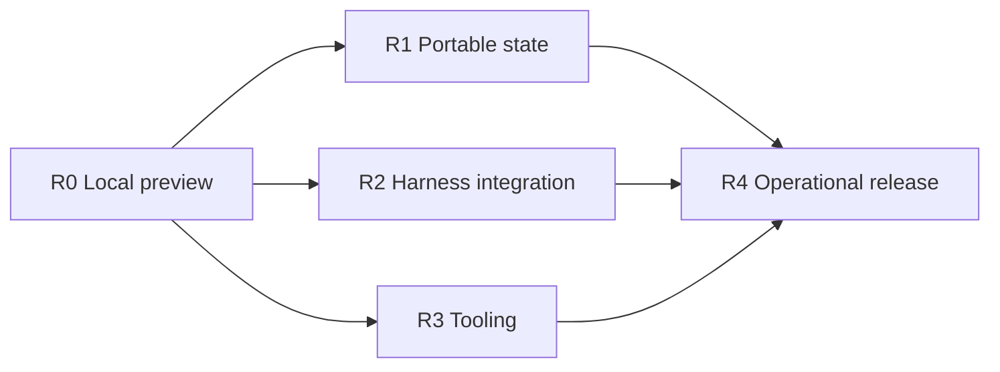

# Implementation plan

The service-integration work is recorded in [12 Service integration readiness](plans/12-service-integration-readiness.md), extending [11 Application SDK and session-bound execution](plans/11-application-sdk.md) and [10 Published clients and subsystem boundaries](plans/10-modernization.md). Earlier work is in [08 Integration expansion](plans/08-integration-expansion.md) and [09 Delivery, documentation, and examples](plans/09-delivery-and-examples.md).

- **Status:** In progress (local runtime, SDKs, HTTP/SSE tools, and archive adapters implemented)
- **Architecture:** [ADR 0001](adr/0001-local-first-session-server.md)
- **Release stages:** [Roadmap](roadmap.md)

This index links the subsystem plans and tracks how they fit together.

| Plan | Focus |
| --- | --- |
| [01 Local runtime](plans/01-local-runtime.md) | Go server, SQLite + event log storage, single-owner session loop, Pi integration, admission limits. |
| [02 External persistence](plans/02-external-persistence.md) | Background 64 KiB block uploads to filesystem/S3/R2/GCS, optional PostgreSQL discovery index, `flush`/`sync`/`restore`. |
| [03 Harness adapters](plans/03-harness-adapters.md) | Runner interface, JSON-over-stdio protocol, Pi runner, and planned OpenCode and Codex adapters. |
| [04 Distributed tools](plans/04-distributed-tools.md) | HTTP/SSE tool dispatch, scoped `inspect_session` tokens, external approval flow, planned MCP and tool catalog. |
| [05 API and SDKs](plans/05-api-and-sdks.md) | HTTP endpoints, SSE cursor semantics, code-generated OpenAPI/SDK types, TypeScript client. |
| [06 Observability and operations](plans/06-observability-and-operations.md) | Structured logs, OpenTelemetry traces/metrics, health checks, container packaging, handoff and load testing. |
| [07 Verification and release](plans/07-verification-and-release.md) | Unit/contract suites, end-to-end journey tests, failure injection, and release criteria. |
| [10 Modernization](plans/10-modernization.md) | Published SDK artifacts, consumer-owned runtime interfaces, tool transports, and local database adapters. |
| [11 Application SDK](plans/11-application-sdk.md) | Application composition, managed/runtime tools, encrypted credentials and shared Pi hosts. |
| [12 Service integration readiness](plans/12-service-integration-readiness.md) | Three harnesses, shared host-pool ownership, server/client model credentials and tool authoring, browser integrations and usage evidence. |

## Working rules

- **Code owns implemented behavior.** Once a slice lands, the Go types, SQL schema, and tests are the source of truth; the plan files track remaining work.
- **Ship complete vertical slices.** Update the server, runner, generated SDKs, docs, and tests together, and verify with `node scripts/check.mjs`.
- **Add dependencies only when needed.** Don't prebuild abstractions or pull in SDKs for unimplemented milestones.

## Repository layout discussion (2026-11-14)

Status: implemented after authorization on 2026-11-14. CI gates merge and release.

- Move the generated Brain HTTP contract from `api/openapi.json` to `services/brain/api/openapi.json`, beside the public Go types owned by that service.
- Keep Go route declarations and wire types as the source of truth, with Huma schema generation, openapi-typescript declarations and CI drift checks. Update generator output paths, website consumers, tests and documentation together when implementing the move.
- Document the contract's source files, regeneration command and consumers beside the artifact so its role is apparent from the directory.
- The placement is an ownership choice for this repository, not a Go or OpenAPI requirement. A single generated OpenAPI document remains appropriate.

Use service-local `cmd/<program>/` consistently for Go executable entry points, root `scripts/` for repository-wide automation, and component-local `scripts/` for automation owned by one component. Keep executable entry points focused on flags, configuration, startup and shutdown, with business logic in ordinary packages. Service entry points now use this layout.

Implementation preference: use popular, established libraries for standard infrastructure and protocol tooling where they fit, rather than maintaining equivalent custom implementations. Prefer the standard library when it already meets the need. The accepted tooling directions below are being implemented.

### SDK and tooling direction

- Remove the Python SDK from the supported implementation scope. Remove its generated types, packaging, publishing, consumer tests, examples and documentation references together. Update the remaining verification suite to match the supported TypeScript SDK; do not leave Python SDK checks disabled or silently skipped. Python used for unrelated repository tasks is a separate concern. This does not request deletion of already published PyPI artifacts.
- Do not adopt `eventsource-parser`: the user does not consider the functionality sufficient to justify this dependency. Retain owned SSE parsing and its protocol tests.
- Use Commander.js for the Node CLI, `openapi-typescript` plus `openapi-fetch` beneath the public TypeScript SDK, and retain Next.js/Fumadocs for the documentation website.
- Replace the custom schema/code-generation machinery with established tooling. Huma (Go-first) and oapi-codegen (contract-first) are alternative approaches, not a combined pipeline. Selected Huma schema generation to retain Go as the source of truth. Existing HTTP handlers retain request validation and transport lifecycles; this does not migrate handlers to Huma middleware. Runtime protocol types outside the HTTP contract still need an owned source and generation path.

### Tooling limits and integration responsibilities

| Tool | Limits and implications for Brain |
| --- | --- |
| [Commander.js](https://github.com/tj/commander.js) | Provides argument parsing, command dispatch and help, not Brain operations. Keep actions on the public SDK. Use `parseAsync()` for asynchronous actions. Configure output/exit handling to preserve the exported CLI entry point's testability and embedding behavior. |
| [openapi-typescript](https://openapi-ts.dev/introduction) | Generates compile-time types, not runtime response validation or business logic. Only describes what the contract represents; it does not replace non-HTTP runtime protocol declarations. |
| [openapi-fetch](https://openapi-ts.dev/openapi-fetch/) | Supplies typed HTTP calls, not the complete ergonomic `Brain` SDK or executor lifecycle. Retain SDK authoring helpers, error translation, telemetry and cancellation semantics. Streaming event parsing and executor WebSocket behavior need explicit integration; do not assume ordinary JSON operations cover them. Preserve existing redirect, timeout and no-automatic-action-replay behavior when configuring the client. |
| [Huma](https://huma.rocks/features/openapi-generation/) | Used for Go-to-schema generation. The existing HTTP handlers retain strict decoding, authentication, error envelopes, binary transfers, SSE and WebSocket lifecycles. Adopting Huma request middleware later would require explicit migration and qualification of those behaviors. Schema generation does not replace tenant and operation authorization. |
| [oapi-codegen](https://github.com/oapi-codegen/oapi-codegen) | A contract-first alternative requiring a source-of-truth change. Generated handlers do not supply complete request validation or authentication by themselves; use the supported middleware and owned authorization logic. Pin and verify a released version's OpenAPI 3.1/schema support: the development README may describe unreleased functionality. Generated Go types cannot express every JSON Schema union precisely. |
| Next.js / Fumadocs | Retain the existing documentation stack. Rendering the OpenAPI document does not validate server conformance or implement SDK behavior. Keep contract generation, endpoint pages and the published download synchronized. Check the emitted contract against the pinned `fumadocs-openapi` version when changing generators. |

These are integration constraints to address during implementation, not findings that the existing behavior is broken. Preserve and run all applicable checks when implementing the agreed scope.

### Sandbox and agent runtime ownership

Agreed: keep Sandbox a generic, separately runnable service. It owns isolated environments, resource limits, process streams, file transfer and environment cleanup. Agent runtimes remain separate from Sandbox's implementation; running inside a Sandbox-managed environment does not make the agent integration part of that service.

Brain owns agent coordination and the Pi-specific protocol adapter, prompt/steering behavior, tool forwarding and coherent checkpoint orchestration. Sandbox executes the installed runtime without implementing those agent semantics. Do not move the complete `runtimes/` tree into Sandbox or add Pi-specific session operations to its generic API.

Keep agent adapters and runnable payloads under `runtimes/`, separately from the generic Sandbox service. Rename the private OS directory lock helper to `internal/dirlock` so the folder names its actual responsibility.

### Credential ownership proposal

Provider credential ownership entirely within Tools, with transparent encryption behind a private scoped storage interface, remains proposed. The existing Brain admission / Tools decryption flow remains implemented and documented in `credentials/README.md`. Individual tool authors receive only their authorized binding credential and do not implement storage encryption. No public decrypt endpoint is planned.

### Public tool naming

Client-executed tools use `BrowserTool`, `BrowserContext` and `BrowserTransport` in the TypeScript API, with `browser_tools` / `browser_transport` for low-level session options. BrowserTool includes attached user client processes. Hosted, remote and browser remain the three tool flavours; agent runtimes are separate. Internal executor wire fields retain their protocol meaning.
