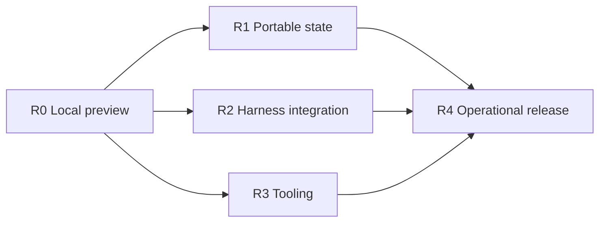

# Brain implementation plan

Status: Local development implementation in progress
Decision: [ADR 0001](adr/0001-local-first-session-server.md)  
Release scope: [Roadmap](roadmap.md)

This index links the implementation plans: M1 server/local state, M2 Pi lifecycle, M3 distributed tools/local release, M4 external persistence, M5 additional integrations, and M6 measured operations/recovery. [Integration research](harness-integration-notes.md) explains current upstream capabilities and limits. All plans use clean breaks by default, including after launch.

| Plan | Owns | Milestones |
| --- | --- | --- |
| [Local runtime](plans/01-local-runtime.md) | Server structure, local state, execution ownership, Pi end-to-end slice, admission, and local release. | M1-M3 |
| [External persistence](plans/02-external-persistence.md) | S3/R2, optional PostgreSQL metadata, synchronization, cache restoration, and checkpoint publication. | M4 |
| [Harness adapters](plans/03-harness-adapters.md) | Minimal lifecycle, Pi/OpenCode/Codex integration, native context, and proven input/restore behavior. | M2, M5 |
| [Distributed tools](plans/04-distributed-tools.md) | HTTP/SSE/MCP, external tool services/catalog, tool-owned approvals, and scoped inspection. | M3, M5 |
| [API and SDKs](plans/05-api-and-sdks.md) | Sessions/events, error/cursor semantics, current generated clients, and examples. | M1-M6 |
| [Observability and operations](plans/06-observability-and-operations.md) | Instrumentation, bounded resource use, packaging, capacity, handoff, and recovery runbooks. | M1-M6 |
| [Verification and release](plans/07-verification-and-release.md) | CI suites, credentialed integration checks, failure/load testing, and release evidence. | M1-M6 |

Start with L1 and corresponding A1, O1, and V1 work. Then implement Pi and one external HTTP tool through the real API. R0 requires restart, reconnect, scope, tool-wait responsiveness, error-boundary, and overload checks. External persistence and additional integrations follow; observability and tests accompany each feature.

The roadmap owns release scope. Each plan owns work items and acceptance checks. Once implemented, schemas/types, SQL, code, and tests own behavior. Update plans when decisions change; keep one current contract. Compatibility work requires an explicit exception to the ADR's clean-break policy.

Keep changes small enough to review and verify. Do not prebuild every interface or provider package. Complete the current end-to-end slice, run all required checks, and move to the next dependency-ready task.

The current cut is for local development. It includes the Pi server, local state, external HTTP/SSE tools, approval/inspection examples, generated clients, telemetry, and filesystem checkpoint recovery. Optional S3/R2/PostgreSQL adapters are present; cloud deployment and live cloud qualification are deferred. Additional harnesses, MCP, the broader tool catalog, global disk accounting, soak/capacity testing, and production release gates remain in the linked plans. This cut does not claim R4 readiness or thousands of measured concurrent harnesses.
