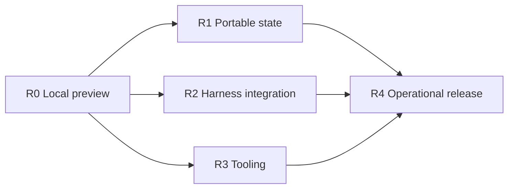

# Implementation plan

The current modernization is recorded in [10 Published clients and subsystem boundaries](plans/10-modernization.md). Earlier work is in [08 Integration expansion](plans/08-integration-expansion.md) and [09 Delivery, documentation, and examples](plans/09-delivery-and-examples.md).

- **Status:** In progress (local runtime, SDKs, HTTP/SSE tools, and archive adapters implemented)
- **Architecture:** [ADR 0001](adr/0001-local-first-session-server.md)
- **Release stages:** [Roadmap](roadmap.md)

This index links the subsystem plans and tracks how they fit together.

| Plan | Focus |
| --- | --- |
| [01 Local runtime](plans/01-local-runtime.md) | Go server, SQLite + event log storage, single-owner session loop, Pi integration, admission limits. |
| [02 External persistence](plans/02-external-persistence.md) | Background 64 KiB block uploads to filesystem/S3/R2/GCS, optional PostgreSQL discovery index, `flush`/`sync`/`restore`. |
| [03 Harness adapters](plans/03-harness-adapters.md) | Runner interface, JSON-over-stdio protocol, Pi runner, and planned OpenCode and Codex adapters. |
| [04 Distributed tools](plans/04-distributed-tools.md) | HTTP/SSE tool dispatch, scoped `inspect_session` tokens, external approval flow, planned MCP and tool catalog. |
| [05 API and SDKs](plans/05-api-and-sdks.md) | HTTP endpoints, SSE cursor semantics, code-generated OpenAPI/SDK types, TypeScript and Python clients. |
| [06 Observability and operations](plans/06-observability-and-operations.md) | Structured logs, OpenTelemetry traces/metrics, health checks, container packaging, handoff and load testing. |
| [07 Verification and release](plans/07-verification-and-release.md) | Unit/contract suites, end-to-end journey tests, failure injection, and release criteria. |
| [10 Modernization](plans/10-modernization.md) | Published SDK artifacts, consumer-owned runtime interfaces, tool transports, and local database adapters. |

## Working rules

- **Code owns implemented behavior.** Once a slice lands, the Go types, SQL schema, and tests are the source of truth; the plan files track remaining work.
- **Ship complete vertical slices.** Update the server, runner, generated SDKs, docs, and tests together, and verify with `node scripts/check.mjs`.
- **Add dependencies only when needed.** Don't prebuild abstractions or pull in SDKs for unimplemented milestones.
