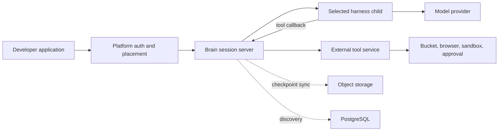

# 08: Integration expansion

Status: Implementation authorized on 2026-10-15. Extends R1–R4 in the [roadmap](../roadmap.md) and [ADR 0001](../adr/0001-local-first-session-server.md).

Evidence and alternatives live in [integration research](../research/integration-options.md). Release setup, examples, and documentation live in [plan 09](09-delivery-and-examples.md). Code and passing tests remain the authority for what is supported.

## Delivery order

| Slice | Outcome | Dependencies and exit gate |
| --- | --- | --- |
| I1: Contract baseline | Reusable harness, storage, and tool conformance fixtures; honest support matrix. | Existing local tests pass unchanged. Each integration identifies exactly which fixtures it must pass. |
| I2: Persistence | Qualify S3/R2, add GCS as the third cloud object adapter, document hosted PostgreSQL. | Local contracts plus real-provider round trips, immutable writes, error mapping, and empty-cache restore. Credentials required for live qualification. |
| I3: MCP | Remote MCP tools use Brain's existing tool authorization, limits, and error semantics. | Local MCP fixture exercises discovery, calls, cancellation, malformed responses, and unknown outcomes. |
| I4: Useful tool catalog | Storage, search/fetch, and sandbox services run independently of Brain. | Each package has a runnable example, tenant tests, bounded output, cleanup, and provider-specific qualification status. |
| I5: More harnesses | OpenCode and Codex use the same queue/interrupt/resume baseline as Pi. | Each must prove exclusive external tools, passive cold restore, compaction recovery, and correct next-turn context. |
| I6: Capacity and operations | Measured concurrent workloads, bounded retries, and practical handoff examples. | Publish workload/hardware details; multi-instance tests prove one live owner per session. |

Run the two new harness feasibility probes early. A failing mandatory invariant blocks that adapter's support claim, not unrelated tool or persistence work. A narrow, tested upstream patch is acceptable for an important control; a second orchestration framework is not.

## Keep the existing ownership boundaries

- Keep sessions, messages, tools, and configuration as the developer vocabulary. Provider jobs and sandbox handles are tool data, not new Brain resources.
- Continue language-neutral HTTP/SSE tool services. Provider keys in host/service configuration are sufficient; no account connection UI or OAuth broker is required.
- Keep Go for the server and storage adapters, TypeScript for harness SDK bridges and browser tools, and Python only where a provider's mature SDK makes it worthwhile.
- Storage adapters remain compiled Go implementations. Harnesses already have a process boundary; tools already have a network boundary. Do not add a dynamic plugin loader or public package hierarchy just to register implementations.
- Every selected tool flows through Brain. Native harness permissions must not create a second business-approval flow. Tools enforce their own approvals; an unexpected harness approval request is an adapter integration failure.
- Keep frozen session configuration for this expansion. The proposed `session.configure` event in [plan 05](05-api-and-sdks.md#future-configuration-updates-proposed) remains the later path; no competing patch API or config-version resource.
- Queueing is the common input baseline. Steering, rewind, changing tools during a turn, and arbitrary transcript editing are outside this cut. Unsupported operations fail explicitly.
- Do not add prompt-prefix hashing or synthetic model heartbeats. Preserve native context and let the harness/provider own prompt construction and caching.

## I1: Shared conformance

Reuse the recording provider, HTTP tool fixture, and real-process journeys. Extract reusable fixtures only where the second integration needs them; avoid a new test framework.

| Boundary | Required observations |
| --- | --- |
| Harness | Open/read/restore are passive; only one turn executes; queue order and interruption hold; tool set is exact; provider errors and adapter failures remain distinct. |
| Native checkpoint | Restart and cold restore preserve prior tool pairs and compaction context in the next outbound model request. No remote action is replayed. |
| Object store | Bounded get/put, immutable create, mutable pointer replacement, missing-object classification, cancellation, and provider auth failures. |
| Tool transport | Input validation before dispatch, identity outside model arguments, bounded streamed output, errors as results, cancellation without a retry. |
| Tenant boundary | Another tenant cannot discover or use a session, job, browser, bucket prefix, or sandbox by guessing an ID. |

Document support as **implemented/local-tested**, **live-qualified**, or **planned/experimental**. These are evidence labels in docs, not new runtime states. A model inventory is not model qualification.

## I2: Persistence adapters and recovery

Keep `Objects.Put/Get` and the 64 KiB block archive. Separate provider configuration inside persistence construction only as required by GCS; the session engine should not switch on cloud vendors.

1. Factor the current object contract into reusable tests. Preserve create-once behavior: a pre-existing immutable key can represent an already-completed write; no full-object hash comparison is required. Archive generation keys own uniqueness.
2. Add GCS using its official Go SDK, create-if-absent preconditions, normal credential discovery, bounded reads, and missing-object normalization. Fail explicitly on invalid combinations of provider settings.
3. Move provider-specific permanent-error classification to the adapter boundary as soon as a non-S3 provider needs it. Use a small error wrapper or predicate; do not build a generic cloud error taxonomy.
4. Test S3 and R2 separately, including interrupted publication and restore into a new local directory. SDK transport fixtures remain in ordinary CI; credentials never turn a live test into a silent skip.
5. Add direct/session-pooled PostgreSQL examples for Neon and Supabase. Qualify transaction pooling before documenting it as supported. Keep the database an eventual index, not a lease or global session mutex.

The sync worker is currently serial across sessions. Measure its backlog under realistic remote latency. If it is the bottleneck, add a small bounded worker pool with one in-flight publication per session; retain the existing per-session gate. Bound the combined SDK and outer retries by one elapsed-time budget, retry only transient storage operations, and stop admission at saturation. Do not add a broker.

Retention needs care: a recent checkpoint can reference old blocks. A blanket object-age lifecycle rule can destroy a live checkpoint. Initially document whole-session retention and provider backup procedures; add manifest-aware garbage collection only with an explicit deletion/retention feature.

## I3: MCP as a tool transport

Use the official Go SDK, pinned to a release that supports the chosen current protocol. Start with remote Streamable HTTP, host-supplied API keys, and tools only.

- Keep validation/auth/output accounting in the existing registry. Factor a small invocation boundary when the MCP implementation needs it; do not duplicate policy in every harness.
- Host configuration selects the server, credentials, allowed tenants, and selected remote tools. Resolve descriptions and schemas before use, validate them, and freeze the selected definitions for the session. Do not silently install newly discovered tools into a running session.
- Use deterministic tool names; reject collisions and unsupported schemas. Do not silently rename a model-visible tool after session creation.
- Map content and structured results into Brain's existing result envelope. Preserve meaningful text/image data within current limits; unsupported content must produce an explicit tool error rather than disappear.
- Propagate cancellation and progress according to the pinned protocol. Keep Brain's transport keepalives out of model context. A connection failure after dispatch has an unknown outcome and is never automatically replayed.
- Keep credentials and connection state scoped to the configured binding. MCP metadata is attribution, not proof of authorization; external servers must authenticate Brain and enforce their resource grants.
- No backward-protocol compatibility code, local command execution, automatic OAuth enrollment, sampling, or resource/prompt catalog is required. Reject unsupported features rather than emulating them badly.

## I4: External tool catalog

Keep catalog implementations outside `internal/session`. Prefer separate commands/packages with explicit dependencies and deployment instructions. Reuse the current descriptor and request/result shapes; generate examples and docs from actual tool descriptors.

| Service | First workflow | Scope and safety boundary |
| --- | --- | --- |
| S3/R2 storage | List, read, write, and delete objects in a configured tenant prefix. | Operator chooses bucket and prefix. Model arguments cannot select checkpoint storage or arbitrary credentials. Mutations require the service's policy. |
| Web research | Brave/Tavily search and bounded public URL fetch. | Search results keep source URLs. Fetch validates DNS/redirect destinations and rejects private/metadata networks, unsafe schemes, oversized or decompression-bomb responses. No regex-only HTML parser. |
| Managed sandboxes | Create, execute, inspect, and terminate a provider sandbox. | Start with a small common operation set across selected providers. Sandbox IDs remain tool data; every operation checks ownership, bounds runtime/output, and reports exit status. |
| Fly Machines | Start a configured image, inspect execution, stop/destroy. | Tool service controls images, machine size, network, and spending limits. The model does not receive an unrestricted cloud control token. |
| Browser | Navigate/read/interact in an isolated browser context, then an explicitly paired current-browser bridge. | Scope browser handles to tenant/session. Disconnection is a tool error; reconnect never replays clicks or form submissions. |

Sandbox provider research and implementation should include Modal, E2B, and Daytona, with Fly for machine-level control. Prefer official SDKs when they avoid reimplementing sandbox transport/lifecycle; direct HTTP is enough for small REST surfaces. Pin dependencies and keep them out of the Brain executable. Confirm provider-specific limits and test credentials before claiming live support.

The common sandbox feature set can be deliberately small. Do not promise checkpoint portability across providers, arbitrary Docker workloads, persistent filesystems, GPUs, or interactive terminals unless each advertised provider supports and tests them. Provider-specific extras can be separate tools later.

**Long-running operations:** Either stream a final result within the configured timeout or return a scoped job handle promptly with status/cancel tools. A job handle is not authorization. If a service needs to survive its own restart, persist its ownership mapping in that service or use verifiable provider metadata; never trust model-supplied tenant IDs. No Brain scheduler polls on behalf of the model.

**Cleanup:** Provider timeouts are the outer bound. Attempt normal cleanup when work ends or is cancelled; record cleanup failures so an operator can resolve them. A bounded service-owned cleanup retry is justified by orphaned paid resources, unlike retrying an ambiguous model action.

**Secrets:** Tools can require API keys. Keys belong in host/service environment variables, secret files, or deployment secret stores. Never put them in tool arguments, transcripts, model-visible descriptors, committed examples, or test reports.

## I5: Harness implementation gates

### Pi

Keep its current SDK integration as the reference. Pin upgrades and rerun the real-provider-recording tests; upstream defaults for tools, resources, and cache warming must not silently change Brain behavior.

### OpenCode

Prefer the v2 embedded SDK inside an isolated TypeScript child process. Bind Brain tools through its plugin hooks, remove native bypass tools, disable warming and ambient config/plugins, and isolate native state per Brain session. Do not expose OpenCode projects/locations as Brain concepts.

The first spike must capture: the actual provider tool list; a silent tool wait plus interrupt; state after compaction; and opening a copied checkpoint after an unclean shutdown with zero provider/tool calls. Explicitly suppress automatic startup recovery. If upstream cannot do this, maintain a small pinned patch with an invariant test and an upstream reference.

### Codex

Use App Server over stdio. Map a Brain session to a native thread and bridge dynamic tool callbacks to the existing dispatcher. The adapter translates protocol-specific result/error fields; it must not run a second model loop.

Prove that the configured binary exposes only Brain-selected tools and cannot execute local commands through alternative paths. Keep the app-server listener private. Use isolated native storage and provider configuration, and fail if required tools or saved state cannot be loaded. Do not treat an empty history response as a valid cold restore.

### Native state extension, only where needed

The current file contract handles append-only prefixes. A mutable database requires a coherent native snapshot or native export, not a byte copy of a live database. Extend `NativeFile` with explicit append-prefix versus immutable-snapshot semantics only when a chosen harness proves the need. The adapter creates the snapshot and defines restoration; Brain handles bounded files and storage.

Each snapshot must remain valid until the asynchronous uploader finishes. Test restore on a different directory and machine identity. Measure local bytes copied and remote bytes uploaded for 100, 500, and 1,000 turns; a full growing database export every turn cannot pass the long-session gate. Avoid a cross-harness transcript format or generic database replication engine to solve this.

If the stable supported subset cannot meet passive restore or tool isolation even with a narrow patch, keep that runner explicitly experimental and ship the passing integrations. Record the concrete blocker and test, rather than claim parity.

## I6: Performance and operational evidence

Use the existing test stack before adding a load-testing dependency. Separate idle sessions, active model requests, silent tool waits, loaded harnesses, and SSE observers in every report.

- Measure 1,000 retained sessions and progressively increase concurrent active sessions with a deterministic provider. Then run 1,000 active sessions across multiple instances with explicit owner routing. This is a workload target, not a claim that one small machine runs 1,000 harness processes.
- Report p50/p95/p99 admission and interrupt latency, runner RSS/startup time, tool dispatch overhead, queue depth, archive lag, uploaded bytes, and errors. Include a slow tool, slow SSE consumer, failing archive, and failed telemetry collector.
- Compare cumulative checkpoint writes at N and 2N turns; unchanged history must not be rewritten every turn. Measure compaction separately.
- Keep storage/network operations out of global locks where independent sessions can proceed. Change serial hydration or synchronization only when the measured workload demonstrates contention.
- Handoff: stop admission to the old owner, interrupt/settle, flush, stop the old process, restore the recorded checkpoint on the new owner, then resume explicitly. If the old owner cannot be proven stopped, the platform must fence it before starting another owner.
- Test process kill, whole-cache loss, archive/index outage, and recovery to the last complete checkpoint. State the observed loss window; do not promise a fixed RPO from a sync interval alone.

## Definition of done

A slice lands with implementation, executable examples, generated contract changes if needed, focused failure tests, and docs describing the actual supported subset. Run the complete required CI suite; do not skip existing tests. Live-provider absence is reported as unqualified, never successful. Release and deployment use the exact verified commit/artifact as described in plan 09.
